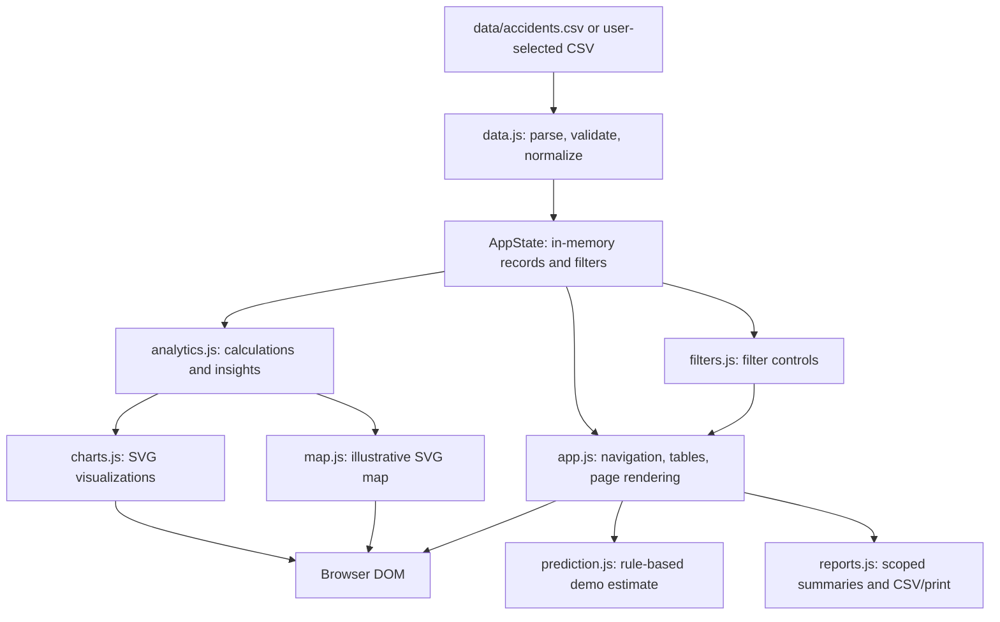

# Libya Traffic Intelligence

A client-side dashboard for exploring a synthetic road-accident dataset representing Libya. It demonstrates CSV ingestion and validation, interactive filtering, statistical summaries, SVG charts and a stylized location map. It is an educational/demo project, not an official traffic-information service.

> **Data notice:** `data/accidents.csv` contains 2,000 synthetic records dated from 2022 through 2026. It is not official Libyan government data and must not be used to make operational road-safety decisions.

## Contents

- [Purpose and scope](#purpose-and-scope)
- [Features](#features)
- [Architecture](#architecture)
- [Technology and project structure](#technology-and-project-structure)
- [Data and calculations](#data-and-calculations)
- [Run locally](#run-locally)
- [Deployment](#deployment)
- [Use the dashboard](#use-the-dashboard)
- [Security and privacy](#security-and-privacy)
- [Testing and project status](#testing-and-project-status)
- [Limitations and future work](#limitations-and-future-work)
- [Contributing](#contributing)
- [License and credits](#license-and-credits)
- [Detailed documentation](#detailed-documentation)

## Purpose and scope

The project shows how a small, static web application can turn structured accident records into browsable summaries without requiring a server-side application or third-party visualization libraries. Users can inspect the supplied sample, compare subsets, and export scoped records for further review.

All processing is performed in the browser. The application does not provide user accounts, authoritative statistics, a trained machine-learning model, or live traffic data.

## Features

- Dashboard KPIs, monthly trend, severity and accident-type distributions, hourly chart, recent records, and data-derived insights.
- Accident table with sorting, pagination, global text search, and filters for location, type, severity, cause, conditions, date components, and time of day.
- Analytics for temporal, geographic, severity, cause, weather, and road-condition distributions.
- Stylized Libya map with point and density-blob views, pan/zoom controls, and accident details. The outline and projection are illustrative.
- A transparent, weighted dataset risk score and a separate rule-based demo predictor. Neither is a validated safety or machine-learning model.
- Report summaries scoped by date, city, severity, and accident type, with CSV export and browser print.
- Local CSV upload fallback when automatic loading is unavailable.
- Responsive layout, visible keyboard focus, a skip link, and keyboard-operable data tables and modal controls.

## Architecture

The app is served as static files. `index.html` loads classic JavaScript modules in dependency order; the modules share browser-global objects and the in-memory `AppState`.



There is no backend, database, build step, package manager, or runtime dependency download. See [docs/ARCHITECTURE.md](docs/ARCHITECTURE.md) for module responsibilities and data flow.

## Technology and project structure

- HTML5, CSS, vanilla JavaScript (ES6+), and SVG.
- The browser Fetch and File APIs load the CSV; Blob and object URLs support CSV downloads.
- No framework, external charting or mapping library, or package manifest.

```text
.
├── index.html
├── assets/           # favicon and Lucide icon subset license
├── css/              # base, dashboard, component, and responsive styles
├── data/
│   └── accidents.csv # synthetic demonstration data
├── docs/             # SRS, architecture, development, deployment, and security notes
└── js/               # data, analytics, rendering, UI, and export modules
```

## Data and calculations

The CSV has 31 columns covering record ID, date and time, location and coordinates, accident classification and severity, vehicles, injuries and fatalities, estimated damage, environmental conditions, road closures, response time, vehicle types, weekend/rush-hour flags, and a supplied per-record risk label.

On load, the application checks required fields, numeric values, dates and weekday consistency, coordinate ranges, categorical severity/risk values, and consistency of weekend/rush-hour and road-closure fields. It derives the numeric hour from each record's time. The weekend convention is Friday/Saturday; the rush-hour flag marks hour values 07–09, 13–16, and 19–21.

KPIs and charts are calculated from the selected records in memory. The overall 0–100 risk score is a weighted heuristic calculated from the selection. The risk-level distribution chart instead counts the `risk_level` labels supplied in the CSV; these are distinct calculations. City and road rankings are raw record counts, not rates adjusted for population, traffic volume, or road length.

## Run locally

Use any static HTTP server from the repository root. For example, with Python installed:

```sh
python -m http.server 8080
```

Open <http://localhost:8080/> in a modern browser. On Windows, `py -m http.server 8080` may be used if the `python` command is unavailable.

The app fetches `data/accidents.csv` relative to the project root. Opening `index.html` directly with a `file://` URL may prevent the browser from fetching the CSV; use a local server or select the CSV through **Load CSV File**.

There are no environment variables or setup dependencies. The repository has no build or install command.

## Deployment

The project can be hosted as a static site: publish the repository files with `index.html` as the entry point, preserve the relative asset paths, and ensure the host serves `data/accidents.csv`. No build or server-side runtime is required. Use HTTPS for a public deployment. See [docs/DEPLOYMENT.md](docs/DEPLOYMENT.md).

## Use the dashboard

1. Start a static server and wait for the dataset to load.
2. Use the sidebar to select a page. Dashboard and analytics values respond to the active accident filters and search.
3. Open an accident row or recent record to view its fields and mapped point.
4. On **Hotspots**, switch between points and heatmap-style density blobs, and use the controls or pointer gestures to change the map view.
5. On **Risk Analysis**, review the dataset-level heuristic or submit conditions to the rule-based demo predictor.
6. On **Reports**, select report parameters, generate a summary, then export its scoped records to CSV or print the report.

The report builder starts from the complete loaded dataset and uses its own report parameters; it is separate from the global accident filters.

## Security and privacy

This is a local, client-side demonstration with no authentication, authorization, server-side storage, or third-party data integration. Uploaded CSV files are parsed in the browser and are not intentionally uploaded. CSV reports are generated as browser downloads. A CSV must contain the required schema and satisfy the documented validations.

Do not treat this demo as a secure multi-user application or use it to process confidential or production personal data. Spreadsheet-formula-like values are neutralized during CSV export. Further boundaries and deployment considerations are in [docs/SECURITY.md](docs/SECURITY.md).

## Testing and project status

The repository does not currently include an automated test suite, linter configuration, build configuration, or CI workflow. Local browser checks verified the 2,000-record dashboard, the single-category donut, keyboard modal focus/return, invalid CSV rejection without replacing loaded data, map mode, prediction, report generation/date-range validation, and no horizontal overflow at 375px. No uncaught page errors were observed during the tested flows. See [docs/DEVELOPMENT.md](docs/DEVELOPMENT.md) for the manual checklist and verification limits.

Implemented functionality is limited to the browser-based demo described above. No production-readiness, statistical validity, accessibility conformance, or deployment certification is claimed.

## Limitations and future work

- The dataset is synthetic and provides no evidence about real accident patterns.
- The map outline, linear coordinate projection, and heatmap blobs are illustrative, not a surveyed or validated GIS product.
- City and road rankings count records without exposure or population normalization.
- The risk score and prediction are heuristics, not validated models; the predictor is rule-based, not trained ML.
- Large CSV files may use substantial browser memory; there is no server-side processing or persistence.
- The project has no automated regression tests and has not been verified across a browser compatibility matrix.
- Potential future work includes sourced data with appropriate permissions, statistically validated models, automated tests, and an API-backed architecture. These are ideas, not implemented features.

## Contributing

Before proposing changes, review the project-specific guidance in [docs/DEVELOPMENT.md](docs/DEVELOPMENT.md). Keep the static architecture unless a change explicitly calls for a backend, preserve the synthetic-data notice, and distinguish implemented behavior from proposals. No automated test command is configured; include manual verification steps with changes.

## License and credits

No project-level license or copyright statement is present in the repository. Ownership and permission to redistribute the project have not been established here, so no license has been inferred or added. The included Lucide icon subset has its separate ISC license in [assets/lucide-LICENSE.txt](assets/lucide-LICENSE.txt).

The project author or maintainer is not identified in the available project files.

## Detailed documentation

- [Software Requirements Specification](docs/SRS.md)
- [Architecture](docs/ARCHITECTURE.md)
- [Development and manual verification](docs/DEVELOPMENT.md)
- [Static deployment](docs/DEPLOYMENT.md)
- [Security and privacy](docs/SECURITY.md)
