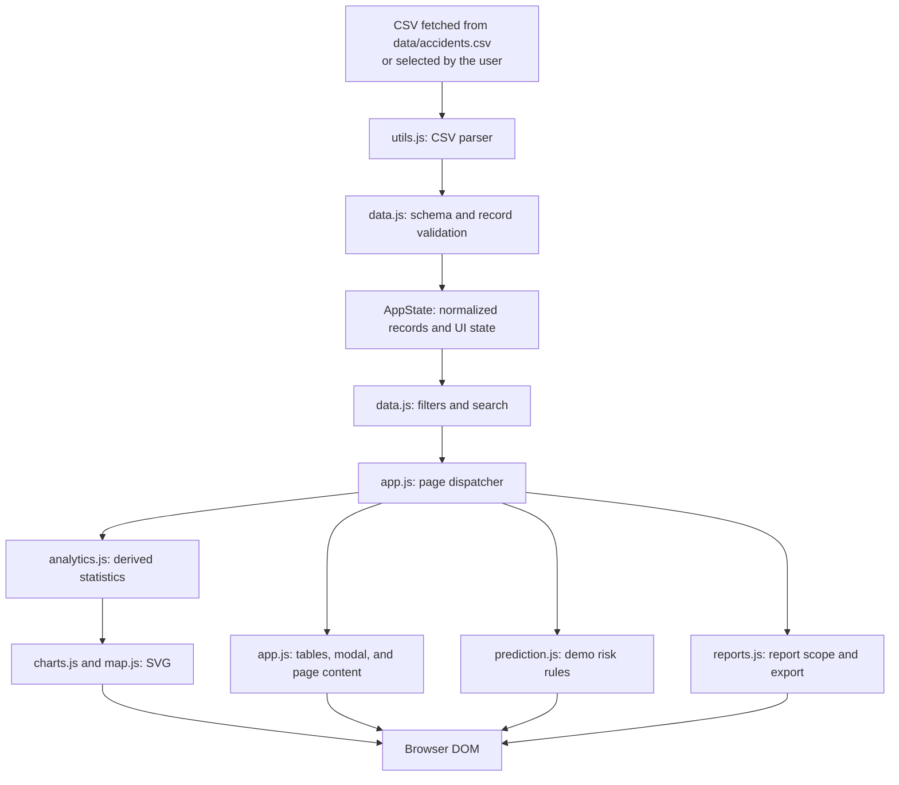

# Architecture

## Scope

Libya Traffic Intelligence is a static, single-page browser application. It has no backend, database, authentication layer, external API, or build pipeline. The UI is assembled from `index.html`, CSS files, and classic JavaScript files loaded in a fixed order at the end of the document.

## Runtime flow

All records and UI state remain in memory for the lifetime of the page. Applying filters derives a new `AppState.filtered` list from `AppState.raw`; analytics functions receive the resulting array and do not persist data.

## Modules

| Module | Responsibility |
|---|---|
| `index.html` | Application structure, accessible names, page content, and script loading order. |
| `js/icons.js` | Installs the bundled SVG sprite containing a subset of Lucide icons. |
| `js/utils.js` | CSV parsing, formatting, DOM helpers, escaping, notifications, and tooltips. |
| `js/data.js` | Shared state, CSV loading, schema and row validation, normalization, filtering, and lookup values. |
| `js/analytics.js` | KPI calculations, distributions, rankings, heuristic risk score, and explanatory insights. |
| `js/charts.js` | Dependency-free SVG chart rendering and tooltips. |
| `js/map.js` | Illustrative coordinate projection, accident points, heatmap-style buckets, and pan/zoom. |
| `js/filters.js` | Filter controls, road options, and active-filter chips. |
| `js/prediction.js` | Transparent rule-based demo risk estimate from form inputs. |
| `js/reports.js` | Report filtering, summary construction, CSV serialization/download, and browser print. |
| `js/app.js` | Startup, navigation, event wiring, page rendering, tables, modal, and integration. |

These are browser-global modules rather than ES modules. Script order in `index.html` is significant: `utils.js` depends on `icons.js`, and later modules depend on the shared objects created earlier.

## Data contract

The CSV has a header row and requires fields listed by `REQUIRED_FIELDS` in `js/data.js`. Every record is checked before it replaces application state. Validation includes non-empty text fields, finite numeric values, integer counts and durations, a positive vehicle count, valid date/time values, date-derived year/month/day agreement, supported severity and risk labels, valid coordinate ranges, binary flags, Friday/Saturday weekend convention, configured rush-hour convention, consistent closure status/duration, and unique accident IDs.

The parser supports quoted fields, escaped quotes, commas, and embedded newlines. The application derives `hour` from `time`; weekend and rush-hour flags are input fields whose consistency is checked.

## Rendering and performance considerations

Tables are paginated in the UI. The map limits point rendering to a deterministic sample of at most 1,200 records; its heatmap groups records into coarse projected cells. Charts and map elements are created with browser DOM/SVG APIs. The application has not been benchmarked, and these limits should not be read as performance guarantees.

## Architectural constraints

- The app requires a browser capable of the JavaScript, Fetch/File/Blob, and SVG features it uses.
- A static HTTP server is recommended because browsers may block `fetch()` for local `file://` URLs.
- Reports and upload processing happen locally in the browser; there is no persistence.
- The map is illustrative and not a substitute for a GIS boundary or geospatial analysis system.
- Dataset-level score and per-record CSV risk labels are separate concepts.
