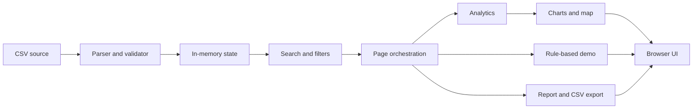

# Software Requirements Specification

## Document information

| Item | Value |
|---|---|
| Project | Libya Traffic Intelligence |
| Document | Software Requirements Specification |
| Version | 1.0 |
| Date | 2026-11-02 |
| Status | Draft; documents the inspected repository implementation |
| Source | Current repository files and supplied synthetic CSV |

## 1. Introduction

### 1.1 Purpose

This specification describes the observable scope, requirements, data contract, and limitations of the current Libya Traffic Intelligence browser application. It is intended for developers, reviewers, educators, and users evaluating the demonstration.

### 1.2 Scope

The product loads a CSV of synthetic accident records in a browser and provides filtering, summaries, charts, a stylized map, a heuristic risk score, a rule-based prediction demonstration, and report export. It is a static educational project, not an official statistics system or operational road-safety tool.

### 1.3 Intended audience

- Developers maintaining or extending the static application.
- Technical reviewers and educators.
- Users exploring the supplied synthetic sample.

### 1.4 Definitions and acronyms

- **Accident record:** One row in the CSV, identified by `accident_id`.
- **Risk score:** The 0–100 aggregate heuristic calculated over a current record selection.
- **Risk label:** The `risk_level` field provided for each CSV record.
- **Synthetic data:** Demonstration data that does not represent official events or statistics.
- **TBD:** Not established by the available repository.

### 1.5 References

- Application entry point: `index.html`.
- Data contract and loading: `js/data.js`, `js/utils.js`.
- Analytics: `js/analytics.js`, `js/prediction.js`.
- User-facing setup and limitations: `README.md`.
- Detailed module, workflow, and deployment notes: `docs/ARCHITECTURE.md`, `docs/DEVELOPMENT.md`, `docs/DEPLOYMENT.md`.

## 2. Overall description

### 2.1 Product perspective

The application is a standalone static web page. The browser loads local static assets and a CSV from the same origin or reads a CSV selected by the user. It stores records and current UI state in memory and renders the interface in the browser DOM and SVG.

### 2.2 Product functions

1. Load and validate a CSV dataset.
2. Show summary values, distributions, and generated descriptive insights.
3. Filter, search, sort, paginate, and inspect accident records.
4. Display accident locations and rankings on an illustrative map.
5. Calculate an aggregate risk heuristic and a separate rule-based estimate.
6. Build a report from user-selected parameters and export its records.

### 2.3 User classes and characteristics

The app has one unauthenticated browser-user class: a person exploring the demo data. There are no administrator, operator, or permission roles. Developer/maintainer users may modify source files and the CSV contract.

### 2.4 Operating environment

- A modern desktop or mobile browser with JavaScript, SVG, Fetch, File, and Blob support.
- A static HTTP server is recommended; direct `file://` use may prevent automatic CSV fetching.
- No server runtime, database, environment variables, or package installation is required.

### 2.5 Design and implementation constraints

- Plain HTML, CSS, and classic JavaScript files; script load order is significant.
- All parsing, analysis, map rendering, and report creation occur in the browser.
- No external runtime library or API is used.
- The supplied data is synthetic, and the map is an illustrative projection.

### 2.6 Assumptions and dependencies

- The user has a compatible browser and JavaScript enabled.
- A served deployment preserves relative paths to `data/`, `css/`, `js/`, and `assets/`.
- The loaded CSV follows the schema and semantic conventions implemented in `js/data.js`.
- No reliability or availability guarantee is specified for a hosting provider.

## 3. System features

### SF-01 — Dataset loading and validation

- **Status:** Implemented.
- **Actor:** Browser user.
- **Description:** Fetches `data/accidents.csv`, with a file-input fallback, then parses and validates rows before storing them.
- **Preconditions:** The CSV is reachable or selected and follows the required schema.
- **Main workflow:** Parse header and rows; validate required fields and record consistency; normalize numeric fields; derive hour; replace in-memory records.
- **Alternative workflows:** Fetch failure displays a file-upload fallback; malformed data is rejected with an error.
- **Postconditions:** Valid rows are available in `AppState.raw` and `AppState.filtered`; failed parsing does not replace existing stored records.
- **Business rules:** IDs must be unique; date components agree; count and duration fields are nonnegative integers; vehicle count is positive; binary flags and closure duration are consistent; weekends are Friday/Saturday; rush hours follow the configured hours.

### SF-02 — Dashboard

- **Status:** Implemented.
- **Actor:** Browser user.
- **Description:** Displays KPIs, charts, recent rows, a risk score, and selected insights for the current global filter selection.
- **Preconditions:** A valid dataset is loaded.
- **Main workflow:** Compute KPIs and distributions from filtered records and render the associated SVG charts and lists.
- **Alternative workflows:** Empty selections show empty-state content and no aggregate score.
- **Postconditions:** Dashboard reflects the current selection.
- **Business rules:** Totals are based only on loaded records; values are not official statistics.

### SF-03 — Accident search, filters, and records

- **Status:** Implemented.
- **Actor:** Browser user.
- **Description:** Supports text search, categorical and time filters, sortable/paginated rows, and a record-detail modal.
- **Preconditions:** A valid dataset is loaded.
- **Main workflow:** Change filters or search; apply the selection; inspect, sort, or navigate matching records.
- **Alternative workflows:** No results show an empty state and reset option.
- **Postconditions:** `AppState.filtered` contains the selection; the table and count reflect it.
- **Business rules:** Search covers record ID, city, district, road, accident type, and possible cause.

### SF-04 — Analytics

- **Status:** Implemented.
- **Actor:** Browser user.
- **Description:** Presents temporal, geographic, severity, cause, weather, and road-condition distributions and generated descriptions.
- **Preconditions:** A dataset is loaded.
- **Main workflow:** Calculate distributions over the current filtered records and render charts and insights.
- **Alternative workflows:** Empty filters render empty states or a no-match insight.
- **Postconditions:** Analytics reflect the current global selection.
- **Business rules:** Rankings are record counts, not exposure-adjusted rates; generated insights describe the synthetic sample only.

### SF-05 — Hotspots and map

- **Status:** Implemented.
- **Actor:** Browser user.
- **Description:** Plots record coordinates on an illustrative Libya map, with point and heatmap-style bucket views and ranked city/road counts.
- **Preconditions:** A dataset is loaded.
- **Main workflow:** Render the current selection, choose a map mode, and use pan/zoom controls.
- **Alternative workflows:** Empty selections show empty ranking/chart states.
- **Postconditions:** Map and rankings reflect the current selection.
- **Business rules:** The map shape/projection are approximate; rankings do not establish officially dangerous places or normalized density.

### SF-06 — Risk analysis and prediction

- **Status:** Implemented.
- **Actor:** Browser user.
- **Description:** Computes a weighted aggregate score over the selection and a separate rule-based estimate from form inputs.
- **Preconditions:** Dataset loaded for the aggregate score; form values selected for the prediction.
- **Main workflow:** View score and factors, or submit the prediction form to calculate a demo score.
- **Alternative workflows:** Empty selection has no aggregate score.
- **Postconditions:** Score, level, and explanatory factors are rendered.
- **Business rules:** Scores are demonstration heuristics, not validated models or advice. Per-record risk distribution counts the CSV-supplied `risk_level`.

### SF-07 — Reports and export

- **Status:** Implemented.
- **Actor:** Browser user.
- **Description:** Builds scoped summary statistics and exports scoped records to CSV or invokes browser print.
- **Preconditions:** Dataset loaded.
- **Main workflow:** Select report date range, city, severity, and type; generate a summary; export or print.
- **Alternative workflows:** An invalid date or reversed date range is rejected.
- **Postconditions:** A report is displayed and CSV export downloads the matching records.
- **Business rules:** Report filters start from all loaded records, independently of global filters; formula-like values are neutralized for CSV output.

## 4. Functional requirements

All requirements below describe implemented behavior unless explicitly marked otherwise. “Implemented” indicates source support; it does not imply exhaustive cross-browser testing.

| ID | Requirement | Status |
|---|---|---|
| FR-001 | The system shall fetch the default CSV from `data/accidents.csv` and report a loading failure in the interface. | Implemented |
| FR-002 | The system shall allow a user to select a CSV file when automatic loading is unavailable. | Implemented |
| FR-003 | The system shall reject a CSV missing any required column or containing rows with an unexpected number of fields. | Implemented |
| FR-004 | The system shall reject records with invalid dates/times, inconsistent date components, unsupported severity/risk labels, invalid numeric values, or out-of-range coordinates. | Implemented |
| FR-005 | The system shall reject duplicate accident IDs and inconsistent weekend, rush-hour, or closure status/duration values. | Implemented |
| FR-006 | The system shall derive hour of day from the validated record time. | Implemented |
| FR-007 | The system shall calculate dashboard KPIs from the current global selection. | Implemented |
| FR-008 | The system shall render temporal, type, severity, city, and hourly charts from the current selection. | Implemented |
| FR-009 | The system shall filter records by the available categorical fields and time bounds. | Implemented |
| FR-010 | The system shall search ID, city, district, road, accident type, and possible cause without case sensitivity. | Implemented |
| FR-011 | The system shall sort and paginate accident records and allow record details to be opened. | Implemented |
| FR-012 | The system shall calculate distributions and insight text from the current filtered selection. | Implemented |
| FR-013 | The system shall render location points and density-style buckets from record coordinates. | Implemented |
| FR-014 | The system shall calculate an aggregate weighted score and a separate rule-based estimate. | Implemented |
| FR-015 | The system shall build reports using the report-specific date, city, severity, and type criteria. | Implemented |
| FR-016 | The system shall export report records as CSV and support browser printing. | Implemented |
| FR-017 | The system shall not claim synthetic records or heuristic scores to be official or validated results. | Implemented |
| FR-018 | The system shall store records only in page memory during the current session. | Implemented |

### 4.1 Planned requirements

No future feature is a committed requirement. Potential directions—real sourced data, a validated model, API integration, and automated tests—are proposals only and are not implemented.

## 5. Non-functional requirements

| ID | Category | Requirement | Status |
|---|---|---|---|
| NFR-001 | Performance | The app shall render the supplied 2,000-record sample in a modern browser; no latency threshold is defined. | Partially Implemented — one local browser smoke check; no benchmark or browser matrix. |
| NFR-002 | Security | The app shall not embed server credentials or transmit selected CSV contents to a backend. | Implemented by current architecture; no formal security assessment. |
| NFR-003 | Reliability | Invalid file parsing shall fail visibly without replacing existing in-memory data. | Implemented in the loader flow. |
| NFR-004 | Availability | Availability depends on the static host and browser; no service-level objective is specified. | Unverified — no hosting provider or availability target. |
| NFR-005 | Maintainability | Source shall remain separated into data, analytics, rendering, and orchestration files. | Partially Implemented — modules exist; no automated style checks are configured. |
| NFR-006 | Usability | Main pages shall be navigable through the sidebar, with filters, search, and empty states. | Implemented in source. |
| NFR-007 | Accessibility | The interface shall provide labels, a skip link, keyboard access for primary navigation and modal behavior, and visible focus styling. | Partially Implemented — source and targeted browser checks; WCAG conformance is unverified. |
| NFR-008 | Scalability | The app shall operate without a backend for the supplied sample; maximum supported dataset size is TBD. | Partially Implemented — sample works; larger-data capacity is unverified. |
| NFR-009 | Compatibility | The app shall use browser APIs available in modern browsers. | Unverified — supported browser/version matrix is TBD. |
| NFR-010 | Data integrity | Values displayed and exported shall originate from loaded records and calculated summaries; invalid rows shall be rejected. | Partially Implemented — client-side validation exists; synthetic values have no real-world validity. |

## 6. External interface requirements

### 6.1 User interface

The interface contains Dashboard, Accidents, Analytics, Hotspots, Risk Analysis, Reports, and About pages. It supports browser viewport resizing, search/filter controls, charts, a table, a modal, and download/print actions.

### 6.2 Software interfaces

- Browser Fetch API for the same-origin CSV file.
- File API for user-selected CSV input.
- Blob/object URL APIs for CSV downloads.
- DOM and SVG APIs for interface and visualizations.
- Browser print for report printing.

### 6.3 APIs and third-party integrations

No application API, database interface, or network integration with a third-party service is implemented. Lucide SVG icon markup is included locally with its license file.

## 7. Data requirements

### 7.1 Main record fields

The CSV is a flat record collection rather than a relational database. It includes a unique `accident_id`; date, time, weekday, month, and year; city, district, road, type, latitude, longitude; accident type and severity; vehicle/injury/fatality counts and estimated damage; weather, road condition, traffic, lighting, possible cause; closure status/duration and emergency response; vehicle type labels; weekend/rush-hour flags; and risk level.

### 7.2 Relationships and constraints

No database entities or foreign-key relationships exist. Each row is an independent accident record. `accident_id` is unique within a loaded file. Date-derived labels must agree with the date; count, duration, and flag constraints are checked in `js/data.js`.

### 7.3 Retention

Records are held in page memory only. There is no client storage or application-managed retention. Exported CSV files are managed by the user's browser.

## 8. System architecture

### 8.1 Overview

`index.html` loads ordered global JavaScript modules. Data normalization updates shared `AppState`; filters derive the current selection; analytics provide pure calculations; the app orchestrator renders UI using SVG and DOM APIs.

### 8.2 Architecture diagram

### 8.3 Component responsibilities

The component assignments are listed in [docs/ARCHITECTURE.md](ARCHITECTURE.md). Communication occurs through shared browser globals, direct function calls, and DOM event handlers.

## 9. Use cases

| ID | Actor | Preconditions | Main scenario | Alternative | Expected result |
|---|---|---|---|---|---|
| UC-01 | Browser user | Page served over HTTP | Load the dashboard. | Choose CSV after fetch failure. | Valid dataset appears, or an actionable load error is shown. |
| UC-02 | Browser user | Dataset loaded | Search, filter, sort, and inspect a record. | No records match. | Current selection is displayed or an empty state is provided. |
| UC-03 | Browser user | Dataset loaded | Open Hotspots and switch map view. | Filter to an empty selection. | Map/rankings reflect the selection. |
| UC-04 | Browser user | Dataset loaded | Enter prediction conditions and submit. | None. | A labeled rule-based estimate and factors are shown. |
| UC-05 | Browser user | Dataset loaded | Select report scope and export. | Reversed date range. | Scoped report is displayed/exported, or invalid range is rejected. |

## 10. Constraints and limitations

- Only synthetic records are supplied; they do not establish real-world patterns.
- The map boundary, projection, and density buckets are illustrative.
- City and road rankings are raw counts.
- Aggregate risk score and prediction are not validated models.
- No authentication, persistence, backend, automated test suite, CI, or deployment configuration is present.
- Browser compatibility and maximum dataset size are not formally established.
- Project license and author/maintainer identity are not established in available files.

## 11. Future requirements

Potential future work includes permissioned authoritative data, exposure-normalized analytics, validated risk models, automated tests, and an API-backed service. Each requires separate requirements, data governance, and validation; none is part of this implementation.

## 12. Requirements traceability matrix

| Requirement | Feature | Relevant modules | Verification reference |
|---|---|---|---|
| FR-001 | SF-01 | `js/data.js`, `js/app.js` | M-01 |
| FR-002 | SF-01 | `index.html`, `js/data.js`, `js/app.js` | M-08 |
| FR-003 | SF-01 | `js/utils.js`, `js/data.js` | M-08 |
| FR-004 | SF-01 | `js/data.js` | M-08 |
| FR-005 | SF-01 | `js/data.js` | M-08 |
| FR-006 | SF-01 | `js/data.js` | M-01 |
| FR-007 | SF-02 | `js/analytics.js`, `js/app.js` | M-01, M-02 |
| FR-008 | SF-02, SF-04 | `js/analytics.js`, `js/charts.js`, `js/app.js` | M-02 |
| FR-009 | SF-03 | `js/data.js`, `js/filters.js`, `js/app.js` | M-02 |
| FR-010 | SF-03 | `js/data.js`, `js/app.js` | M-03 |
| FR-011 | SF-03 | `js/app.js` | M-02, M-05 |
| FR-012 | SF-04 | `js/analytics.js`, `js/charts.js`, `js/app.js` | M-02 |
| FR-013 | SF-05 | `js/map.js`, `js/app.js` | M-06 |
| FR-014 | SF-06 | `js/analytics.js`, `js/prediction.js`, `js/app.js` | M-02 |
| FR-015 | SF-07 | `js/reports.js`, `js/app.js` | M-07 |
| FR-016 | SF-07 | `js/reports.js`, `js/app.js` | M-07 |
| FR-017 | SF-02–SF-06 | `index.html`, `js/analytics.js`, `js/prediction.js` | Source and UI review |
| FR-018 | SF-01 | `js/data.js` | Architecture inspection |

M-01 through M-09 are manual verification references in `docs/DEVELOPMENT.md`, not automated test IDs. The README summarizes the initial data-load/dashboard check and targeted feature checks executed during this work; the remaining checklist items have not all been run. No automated test suite exists.

## 13. Acceptance criteria

For the current demo scope, acceptance is satisfied when:

1. The supplied CSV loads and produces a dashboard showing 2,000 records.
2. Search, filters, sorting, pagination, modal details, and report controls operate on the loaded data.
3. Charts, map, score, and predictor display the calculations described above, with limitations clearly labeled.
4. Invalid CSV structure and invalid report date order are rejected with visible feedback.
5. CSV export contains the scoped records and neutralizes formula-like spreadsheet values.
6. Documentation does not represent synthetic data, raw rankings, or heuristic estimates as official or validated results.

These criteria describe intended behavior; only the checks reported in `README.md` have been executed in this session.
